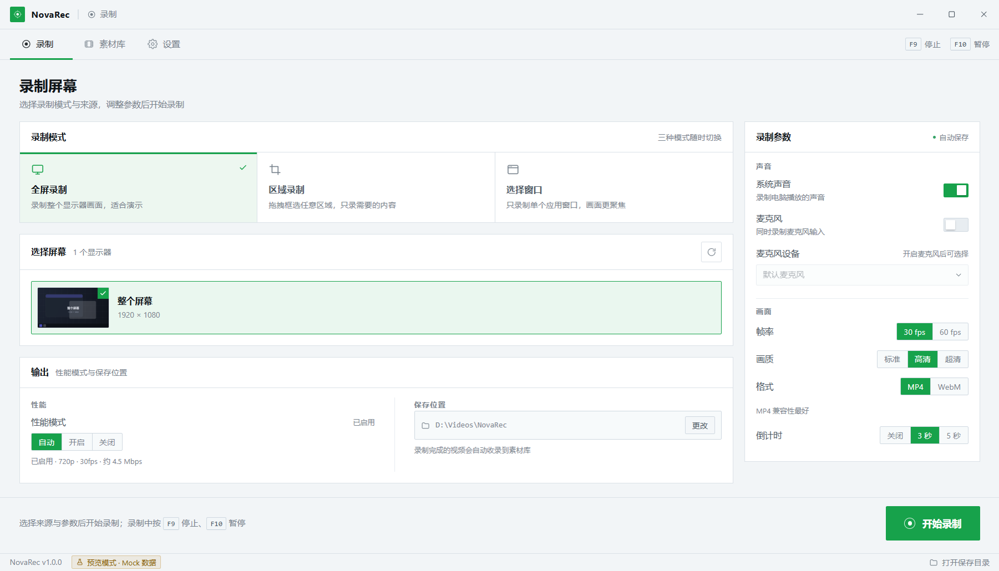
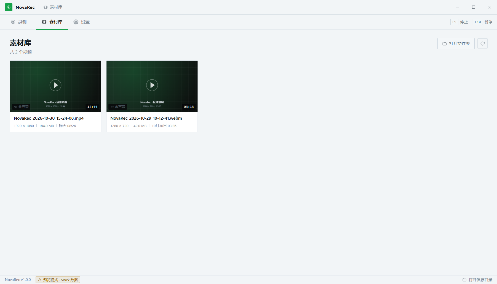
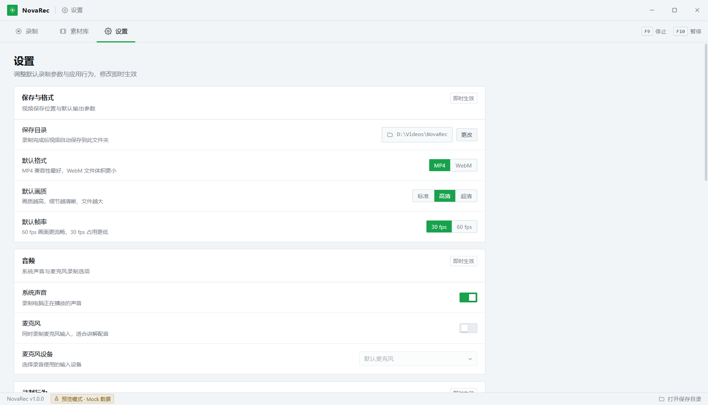
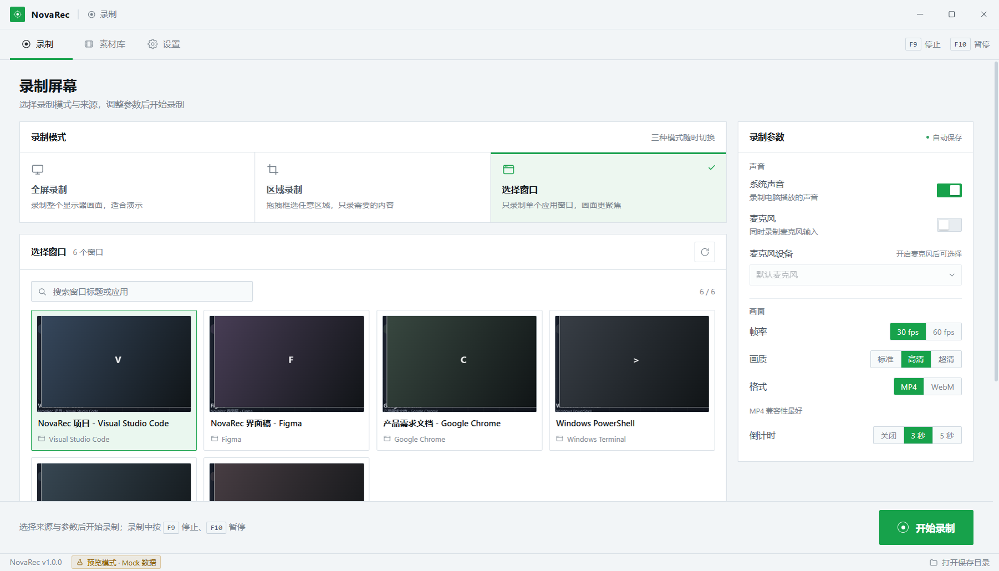
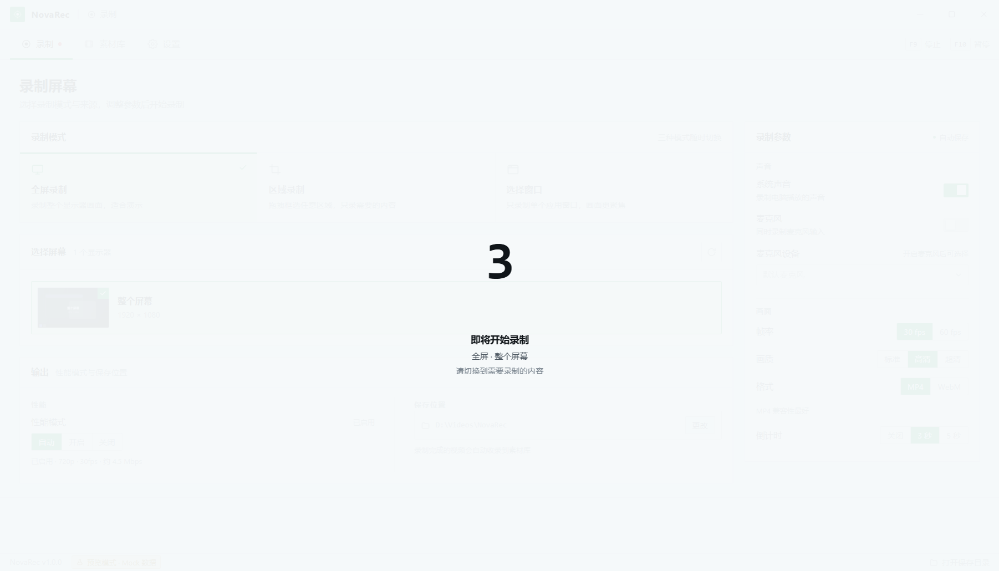
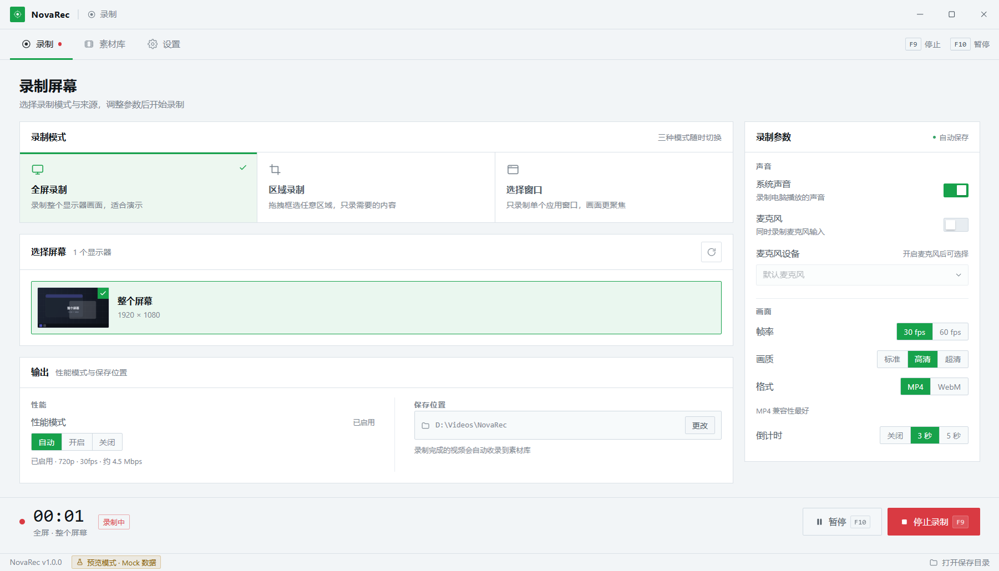

# NovaRec · 免费开源的 Windows 录屏软件

> 全屏录制、截选区域、选择窗口，可同时录制系统声音与麦克风。无广告、无捆绑、无需注册。

**Windows 10 / 11 · x64** ｜ **Electron 45 + Chromium 桌面采集 + 纯 JS 收尾（无 ffmpeg）** ｜ **MIT License** ｜ **v1.1.0**



## 目录

- [功能](#功能)
- [截图](#截图)
- [下载与安装](#下载与安装)
- [从源码运行](#从源码运行)
- [打包与签名](#打包与签名)
- [项目结构](#项目结构)
- [工作原理](#工作原理)
- [已知限制](#已知限制)
- [文档](#文档)
- [许可证与第三方组件](#许可证与第三方组件)

## 功能

- **三种录制模式**：整屏 / 矩形框选区域 / 指定应用窗口
- **声音**：系统声音（默认播放设备 loopback）与麦克风可分别开关，支持混音；也可纯静音录制
- **输出格式**：MP4（H.264 + AAC，兼容性最好）或 WebM（VP9 + Opus），支持帧率 / 画质档位
- **录制控制**：倒计时（关闭 / 3 秒 / 5 秒）、暂停与继续（暂停不计入时长）、F9 停止、F10 暂停/继续
- **不打扰**：开始录制后主窗口自动隐藏，托盘图标 + 托盘菜单控制；单实例运行
- **素材库**：缩略图预览、播放、定位文件、删除（进回收站），录制完成自动入库
- **性能模式**：低配机器自动降到 720p · 30fps 并精简界面动画，录制期间阻止息屏
- **自动更新**：GitHub Releases 直连 + 镜像降级 + 仓库 version.json 回退，检查到新版本后由用户确认下载安装
- **轻量**：安装包 97 MB / 单文件便携 96.7 MB / 便携 zip 129.7 MB / 解压后 285 MB；无内置 ffmpeg，收尾由纯 JS 重封装器完成（毫秒级）
- **中文界面**：浅色 + 单一绿色强调色（#17A24B），无边框自绘标题栏

## 截图

| 录制页 | 素材库 |
| --- | --- |
|  |  |

| 设置 | 选择窗口 |
| --- | --- |
|  |  |

| 倒计时 | 录制中 |
| --- | --- |
|  |  |

## 下载与安装

发布版提供三种形式（见仓库 Releases 页面）：

- **安装包**：`NovaRec-Setup-1.1.0-x64.exe`（约 97 MB），NSIS 安装向导，可自选安装目录，自带卸载程序
- **单文件便携**：`NovaRec-Portable-1.1.0-x64.exe`（约 96.7 MB），一个 exe 双击即用；每次启动会自解压到临时目录，启动比 zip 版慢 2–5 秒
- **便携 zip**：`NovaRec-1.1.0-win32-x64.zip`（约 129.7 MB），解压一次、启动最快，不写注册表（推荐经常使用时优先选它）

系统要求：Windows 10 1809 及以上 / Windows 11，x64；录制系统声音需要有可用的播放设备。

> 便携版与安装包默认**未做商业代码签名**，首次运行可能出现 SmartScreen「未知发布者」提示，选择「更多信息 → 仍要运行」即可；v1.1.0 的构建产物未签名（v1.0 曾用本机自签名证书）。自行构建并签名的方法见 [docs/build.md](docs/build.md)。

v1.1.0 相对 v1.0.0：安装包 122 MB → 97 MB、便携 zip 173 MB → 129.7 MB、解压后 421 MB → 285 MB；移除内置 ffmpeg.exe（-61.5 MB）与 53 个语言包（-47.7 MB）、删除 WebGPU 着色器编译器 dxcompiler.dll（-24.6 MB）、排除未使用图标母版（-1.2 MB）；倒计时结束到开录从 256–284 ms 降到 5–16 ms、窗口可见从约 1.2 s 提前到约 0.3–0.4 s；新增自动更新与单文件便携版。详见 [CHANGELOG.md](CHANGELOG.md)。

## 从源码运行

需要 **Node.js 20+**（本项目在 Node 24 上开发验证）与 Windows 10/11。

```bash
git clone https://github.com/<your-org>/novarec.git
cd novarec
npm ci
```

`npm ci` 之后如果 `node_modules/electron/dist` 为空（npm 12 会阻止第三方 postinstall 脚本），手动补一次 Electron 二进制：

```bash
node node_modules/electron/install.js
# 国内网络可先设镜像：
# set ELECTRON_MIRROR=https://npmmirror.com/mirrors/electron/
```

启动：

```bash
npm start
# 若所在环境因 Chromium 沙箱导致进程直接退出（rc=3），改用：
npm run start:nosandbox
# 或 set NOVAREC_NO_SANDBOX=1
```

数据目录优先级：`NOVAREC_DATA_DIR` 环境变量 → 开发态 `<repo>/.data`（已在 .gitignore 中）→ 打包态 exe 同级 `NovaRecData`（便携，解压即用）→ 不可写时退回 `%APPDATA%\NovaRec`。

## 打包与签名

```bash
npm run build            # @electron/packager 生成 artifacts/dist/NovaRec-win32-x64 并打 zip
npm run build:installer  # 基于上面的产物生成 NSIS 安装包 artifacts/installer/NovaRec-Setup-<ver>-x64.exe
npm run build:portable-exe # 基于上面的产物生成单文件便携 exe artifacts/portable/NovaRec-Portable-<ver>-x64.exe
npm run cert             # 创建自签名代码签名证书（仅开发/内部测试）
npm run verify           # 校验打包产物是否完整可启动
```

签名、镜像加速、CI 与常见打包问题见 **[docs/build.md](docs/build.md)**。

## 项目结构

```text
.
├─ src/
│  ├─ main/            # 主进程：窗口、托盘、快捷键、IPC、录制编排
│  │  ├─ main.js       #   应用入口、窗口与托盘、IPC 注册
│  │  ├─ sources.js    #   desktopCapturer 源枚举 / 图标 / 窗口 bounds
│  │  ├─ recorder.js   #   录制状态机：倒计时 → 两段式准备 → 采集 → 收尾入库
│  │  ├─ mediafix.js   #   收尾调度：嗅探格式 + 纯 JS 重封装 + 失败回退
│  │  ├─ mp4remux.js   #   纯 JS MP4 重封装（moov 前置 / 补时长 / faststart）
│  │  ├─ webmfix.js    #   纯 JS WebM 重建簇与 Cues（可拖动进度）
│  │  ├─ ffmpeg.js     #   仅开发期兜底/自检用（不随包分发）
│  │  ├─ updater.js    #   自动更新：多渠道检查、下载、校验、安装
│  │  ├─ store.js      #   settings.json / library.json 持久化
│  │  ├─ winbounds.js  #   窗口坐标、DPI、临时目录
│  │  └─ perf.js       #   性能模式判定
│  ├─ preload/         # contextBridge 暴露的 window.api
│  ├─ renderer/        # 主界面（index.html / styles.css / app.js）
│  ├─ capture/         # 隐藏的采集页面：desktopCapturer + MediaRecorder
│  └─ overlay/         # 区域框选覆盖层
├─ assets/             # 应用图标、托盘图标
├─ docs/               # 使用说明、架构、构建文档、截图
├─ scripts/            # 打包 / 签名 / 自测 / 截图脚本
└─ .github/workflows/  # Windows 构建 CI
```

主进程与渲染进程之间的 IPC 契约见 [docs/ipc-contract.md](docs/ipc-contract.md)，整体数据流见 [docs/architecture.md](docs/architecture.md)。

## 工作原理

1. **取画面**：主进程用 `desktopCapturer` 枚举屏幕 / 窗口源，把 `chromeMediaSourceId` 交给隐藏的采集窗口。
2. **采集**：采集窗口调用 `getUserMedia`，video 用 `chromeMediaSource: 'desktop'`，audio 同样走 desktop 通道拿到系统声音（loopback）。
3. **区域录制**：仍采集整屏，再用 canvas 按物理像素裁剪后 `canvas.captureStream()`，因此框选区域不受 DPI 缩放影响。
4. **窗口录制**：优先直接用窗口源；部分系统/应用不允许时，回退为整屏采集后按窗口 bounds 裁剪。
5. **编码与落盘**：采集窗口把 `MediaRecorder` 的数据块直接写入临时文件；停止后用内置纯 JS 重封装器补全时长/索引
   （MP4 做 moov 前置与 faststart，WebM 重建簇与 Cues），不转码、不调用 ffmpeg，实测 10–60 ms，再写入素材库。
6. **两段式启动**：倒计时期间就并行建立采集流与裁剪画布，倒计时结束只创建 MediaRecorder 并开录，延迟 5–16 ms。

## 已知限制

- 仅支持 Windows；整屏录制当前针对主显示器（多屏录制未实现）
- 无摄像头画中画、无剪辑 / 拼接 / 字幕功能
- 窗口录制在部分 UWP / 受保护内容窗口上可能失败，此时自动回退为整屏裁剪
- 系统声音依赖播放设备 loopback：没有活动输出设备时只能录到静音
- 60 fps 依赖硬件编码能力，低端机（如 4 核核显）实测只有约 36 fps；WebM/VP9 走软件编码，低端机 CPU 占用明显高于 MP4
- 自动更新下载的是完整安装包（无增量更新）

## 文档

- [docs/使用说明.md](docs/使用说明.md)：面向用户的完整手册（三种模式、设置项、常见问题）
- [docs/architecture.md](docs/architecture.md)：进程模型、录制数据流、模块职责
- [docs/build.md](docs/build.md)：构建、打包、安装包、代码签名与 CI
- [docs/verification.md](docs/verification.md)：端到端验证记录
- [docs/perf-baseline.md](docs/perf-baseline.md)：v1.1.0 录制性能基准（CPU/内存/帧率/起停延迟）
- [docs/updater.md](docs/updater.md)：自动更新的渠道、发布方式与已知限制
- [docs/release-1.1.0.md](docs/release-1.1.0.md)：v1.1.0 发布清单（上传 Release / version.json / 推送源码三种方式）
- [docs/publish.md](docs/publish.md)：把仓库发布到 GitHub、打 Release 的流程
- [docs/ipc-contract.md](docs/ipc-contract.md)：主进程 ↔ 渲染进程 IPC 契约
- [CONTRIBUTING.md](CONTRIBUTING.md)：参与开发的方式与规范

## 许可证与第三方组件

本项目源码以 **MIT License** 发布，见 [LICENSE](LICENSE)。

打包产物另含以下第三方组件，分发时请一并遵守其许可证：

| 组件 | 用途 | 许可证 |
| --- | --- | --- |
| Electron / Chromium | 运行时 | MIT / BSD 系 |
| （v1.1.0 起不再分发 ffmpeg 二进制） | — | — |
| 图标与界面素材 | 本项目原创 | 随 MIT 发布 |

v1.1.0 起打包产物不含 ffmpeg 二进制与任何生产依赖（asar 内只有本项目代码与图标），分发时只需随包附带 Electron/Chromium 的许可证文本（产物根目录已包含 LICENSES.chromium.html）。
